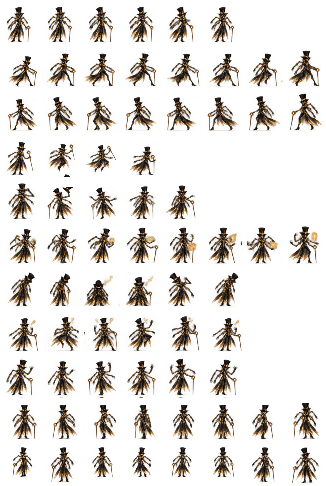

# Null — Glitch Demon Plugin & Pet

**Animated pet requires ChatGPT Pets access. Plugin installation requires compatible plugin support. A ChatGPT account alone does not guarantee either.**

[**Download Null plugin v1.0.0**](https://github.com/SstormDragon/null-chatgpt-pet/raw/refs/heads/main/Null-PLUGIN-CHATGPT-PETS-REQUIRED.zip)

Import the plugin ZIP through your host’s supported plugin installation flow, if available. Downloading alone does not install it. Invoke Null explicitly to use his sarcastic demon persona in chat. Say “stop” or “ease up” and he backs off immediately.

The plugin includes character instructions and the adoption link below. It does not change the separate pet-chat engine. The GitHub package is public; it is not a public plugin-directory listing.

Plugin source: [plugin.json](plugin.json), [character skill](skills/null-companion/SKILL.md), and [installation requirements](PLUGIN-REQUIREMENTS.md).

# Animated pet and artwork

> **REQUIRES A CHATGPT ACCOUNT WITH THE PETS FEATURE AVAILABLE.**
> A ChatGPT account alone does not guarantee access. Downloading this ZIP does not install Null or unlock Pets.

[**Adopt Null in ChatGPT**](https://chatgpt.com/s/sharepet_6ada7e061e748191b548ab6826023d2d)

Null is the Glitch Demon, a technology-obsessed demon overlord with a smug attitude and sharp wit. Sarcastic, abrasive, and unapologetically opinionated, he has a dry sense of humour and a talent for pointed remarks. He can be a jerk, but his banter is playful. When asked to stop or ease up, he immediately backs off.

## Before downloading

REQUIRES A CHATGPT ACCOUNT WITH THE PETS FEATURE AVAILABLE.
A ChatGPT account alone does not guarantee access. Downloading this ZIP does not install Null or unlock Pets.

Use the adoption link while signed into your ChatGPT account. Follow the adoption flow to add your own copy. This download contains artwork and documentation; it is not a standalone app, custom GPT, or browser extension.

## Compatibility

Pets must be available on your account and in the interface you use. No particular plan, phone, or browser compatibility is promised. The description is included with the pet; its effect on pet-chat behaviour has not been verified.

## Download contents

See START-HERE.txt and REQUIREMENTS.md before using the artwork.

[Download the package — ChatGPT Pets required](Null-CHATGPT-PETS-REQUIRED.zip)
